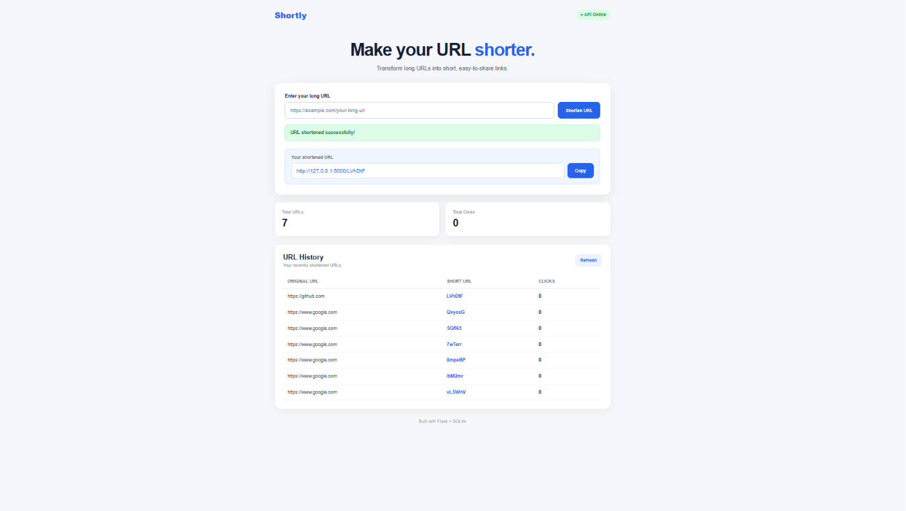
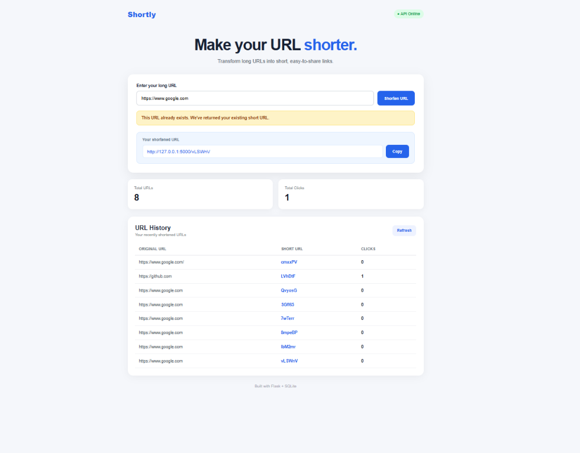

# Shortly — URL Shortener

A simple, responsive URL Shortener web application built with **Python, Flask, SQLite, HTML, CSS, and JavaScript**. It converts long URLs into short, shareable links and redirects users to the original destination.

## Features

- **Short URL generation:** Creates a unique 6-character code for a valid HTTP or HTTPS URL.
- **Fast redirection:** Visiting a short URL redirects to its original destination.
- **Click tracking:** Counts visits to each shortened link.
- **URL history:** Displays shortened URLs and their click counts.
- **Duplicate URL handling:** Returns the existing short link when the same original URL is submitted again.
- **URL validation:** Checks that a URL is provided and uses HTTP or HTTPS.
- **Copy link:** The interface includes a button to copy the generated short URL.
- **SQLite storage:** Saves URL mappings and click counts locally.

## Tech Stack

- **Backend:** Python, Flask
- **Database:** SQLite
- **Frontend:** HTML, CSS, JavaScript
- **Version control:** Git and GitHub

## Screenshots

Screenshots are available in the [`Screenshots`](Screenshots/) folder.

<!-- If your screenshot filenames differ, update these paths to match the files in the Screenshots folder. -->




## Getting Started

### Prerequisites

Install **Python 3** and **pip** on your computer.

### 1. Clone the repository

```bash
git clone https://github.com/Nilavrodas31/URL_SHORTENER.git
cd URL_SHORTENER
```

### 2. Create and activate a virtual environment (recommended)

**Windows PowerShell**

```powershell
python -m venv venv
.\venv\Scripts\Activate.ps1
```

**macOS / Linux**

```bash
python3 -m venv venv
source venv/bin/activate
```

### 3. Install dependencies

```bash
pip install -r requirements.txt
```

### 4. Run the application

```bash
python app.py
```

Open your browser and visit:

```text
http://127.0.0.1:5000
```

The SQLite database (`urls.db`) and its table are initialized by the application when it starts.

## API Reference

The application exposes the following endpoints:

| Method | Endpoint | Description |
|---|---|---|
| `GET` | `/` | Displays the web interface. |
| `POST` | `/api/shorten` | Creates a short URL or returns an existing one for a duplicate URL. |
| `GET` | `/api/urls` | Returns the shortened URL list, including short codes and click counts. |
| `GET` | `/<short_code>` | Redirects to the original URL and increments its click count. |

### Create a short URL

**Request**

```http
POST /api/shorten
Content-Type: application/json
```

```json
{
  "url": "https://www.example.com/some/long/page"
}
```

**Example successful response**

```json
{
  "original_url": "https://www.example.com/some/long/page",
  "short_code": "aB12xY",
  "short_url": "http://127.0.0.1:5000/aB12xY",
  "already_exists": false,
  "message": "URL shortened successfully!"
}
```

The generated code and host in this example are illustrative; the actual values depend on the running application.

### Get all shortened URLs

```http
GET /api/urls
```

Returns a JSON array containing each original URL, short code, short URL, and click count.

### Redirect using a short code

Open a generated short URL in your browser, for example:

```text
http://127.0.0.1:5000/aB12xY
```

Replace `aB12xY` with a code generated by your running application.

## Project Structure

```text
URL_SHORTENER/
├── app.py
├── requirements.txt
├── package-lock.json
├── README.md
├── Screenshots/
├── static/
│   ├── app.js
│   └── style.css
└── templates/
    └── index.html
```

The SQLite database file (`urls.db`) is created at runtime and may not appear in the repository until the application is run.

## Validation and Error Handling

The API checks for a JSON request body, a URL string, empty input, URLs longer than 2,048 characters, and valid HTTP/HTTPS URLs. Requests with invalid input receive an error response. Unknown short codes return a `404` response.

## Future Improvements

- Add user accounts and personal link management.
- Add configurable custom aliases and link expiration.
- Provide more detailed click analytics.
- Deploy the application so it can be accessed publicly.

## Author

**Nilavrodas31**

GitHub repository: [Nilavrodas31/URL_SHORTENER](https://github.com/Nilavrodas31/URL_SHORTENER)

---

If you find this project useful, feel free to star the repository.